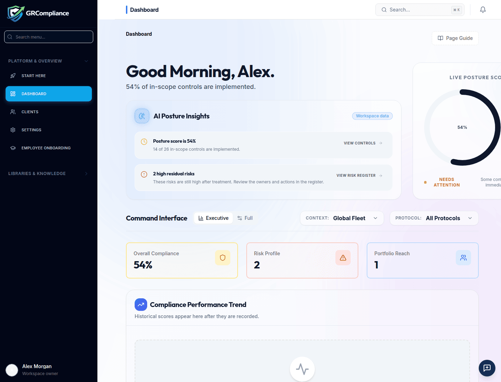
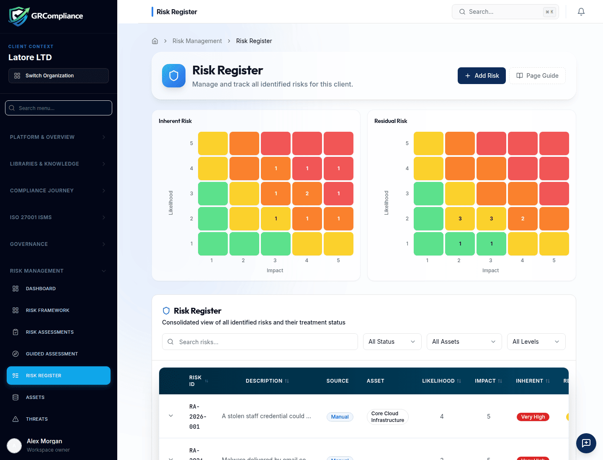
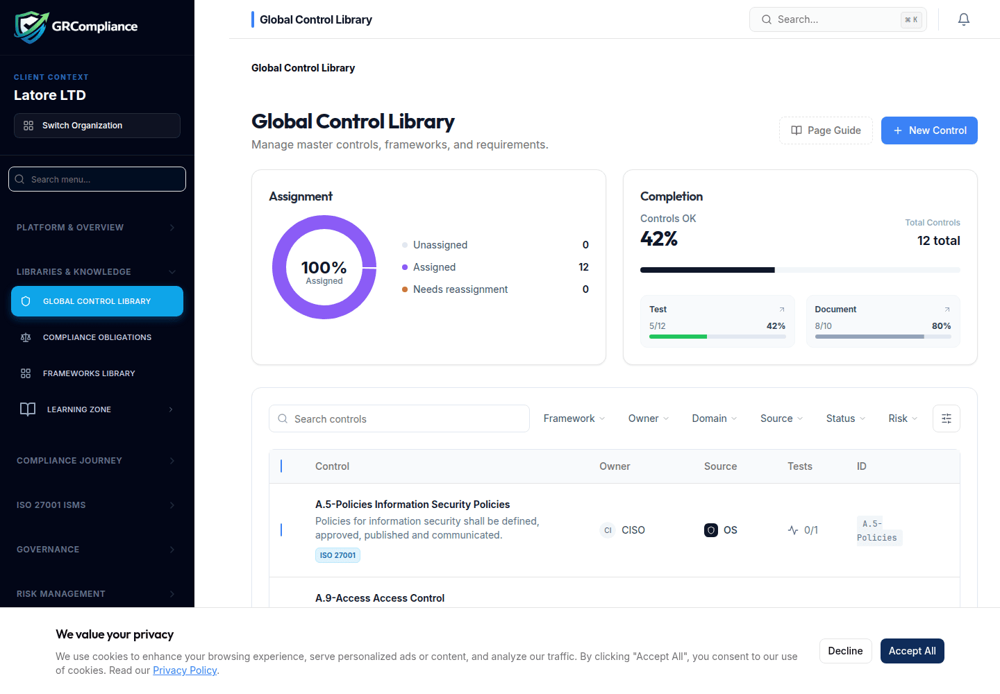
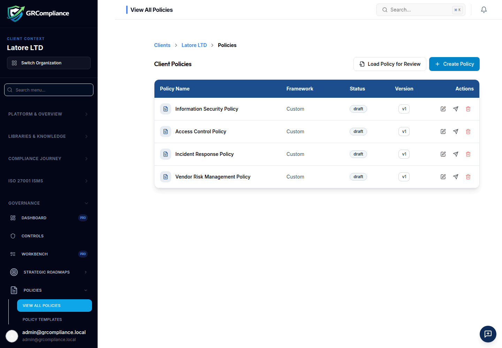
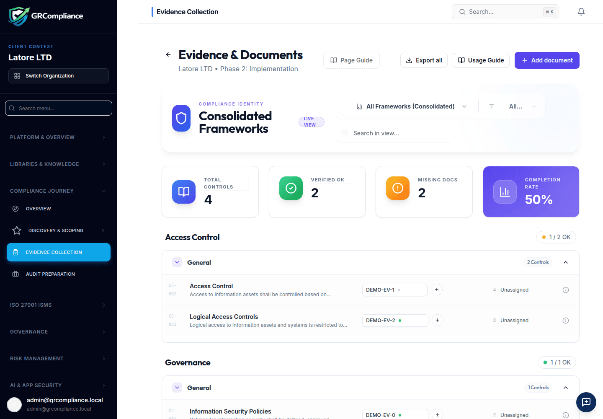

# GRCompliance

Open-source governance, risk, and compliance for teams that run ISO 27001, SOC 2, NIS2, and GDPR in one place.

[](https://github.com/Sectutor/GRCompliance-Core/actions/workflows/ci.yml)
[](LICENSE)
[](https://github.com/Sectutor/GRCompliance-Core/pkgs/container/grcompliance-core)

GRCompliance is the self-hosted core of a GRC platform. It keeps controls, policies, risks, evidence, and audits together so a team can see what is done and what is still open.

The hosted product is at [grcompliance.com](https://grcompliance.com/). The weekly demo is a separate temporary server: [Create your Demo account](https://demo.grcompliance.com). It is reset every week. Do not enter confidential data there.

## Product












## Features

- Frameworks: ISO 27001, SOC 2, NIS2, and GDPR
- Risk register and risk scoring
- Control library and implementation status
- Policies generated from templates
- Evidence linked to controls
- Audit workspace for collected evidence and findings

## Quick start

Docker and the Docker Compose plugin are required. The installer creates `~/grcompliance`, writes a private `.env`, and starts the containers.

```bash
curl -fsSL https://raw.githubusercontent.com/Sectutor/GRCompliance-Core/main/install.sh | bash
```

Windows (PowerShell):

```powershell
irm https://raw.githubusercontent.com/Sectutor/GRCompliance-Core/main/install.ps1 | iex
```

When the health check passes, open the printed URL and sign in with the administrator email. The installer prints the administrator password once. It is stored only in `~/grcompliance/.env` (mode 600). The first start also loads the **Latore LTD** demo workspace, including sample risks, controls, policies, and evidence.

Choose another directory with `--dir` or `GRC_HOME`:

```bash
curl -fsSL https://raw.githubusercontent.com/Sectutor/GRCompliance-Core/main/install.sh | bash -s -- --dir /opt/grcompliance
```

## Manual Docker Compose install

```bash
git clone https://github.com/Sectutor/GRCompliance-Core.git
cd GRCompliance-Core
cp .env.example .env
chmod 600 .env
```

Replace every `replace-with-openssl-rand-hex` value. Generate them with `openssl rand -hex 32` and keep them in `.env` only. Then:

```bash
docker compose up -d --build
```

The app listens on `APP_PORT` (3001 by default). Postgres and Redis are not published to the host.

## Configuration

| Variable | Purpose |
|---|---|
| `POSTGRES_USER` | Database role. Default `grc`. |
| `POSTGRES_PASSWORD` | Database password. Generated by the installer. |
| `POSTGRES_DB` | Database name. Default `grcompliance`. |
| `DATABASE_URL` | Connection string used by the app. Must include `sslmode=disable` for the bundled Postgres. |
| `REDIS_PASSWORD` | Redis password. |
| `JWT_SECRET` | Signs local session tokens. |
| `ENCRYPTION_KEY` | Encrypts sensitive values at rest. |
| `ADMIN_EMAIL` | First administrator. Default `admin@grcompliance.local`. |
| `ADMIN_PASSWORD` | First administrator password. Applied only on first start. |
| `APP_URL` | Public URL of this instance, used in links. |
| `APP_PORT` | Host port mapped to the app. |
| `GRC_VERSION` | Image tag. `latest`, or a `v*` release tag. |
| `AUTH_MODE` | `local` for the bundled login. `supabase` if you bring your own Supabase project. |

Optional integration keys (`OPENAI_API_KEY`, `SENDGRID_API_KEY`, and similar) stay empty unless you set them from your own secret store.

## Upgrade

```bash
curl -fsSL https://raw.githubusercontent.com/Sectutor/GRCompliance-Core/main/install.sh | bash -s -- --upgrade
```

`--upgrade` keeps the existing `.env`, pulls `ghcr.io/sectutor/grcompliance-core`, and recreates the app container. If the image is not published yet, it rebuilds from a git clone. The administrator password is not rotated.

## Backup

From the install directory:

```bash
docker compose exec -T db pg_dump -U grc grcompliance > grcompliance.sql
docker run --rm -v grcompliance_grc_uploads:/data -v "$PWD":/backup alpine \
  tar czf /backup/uploads.tgz -C /data .
```

Restore the SQL file with `psql` inside the `db` container, and extract the uploads archive into the `grc_uploads` volume. Take both backups together.

## Community edition

The image is built with premium features off. A community instance includes one workspace you create plus the free **Latore LTD** demo workspace. The seeded administrator can own both. Additional workspaces need a commercial license from [grcompliance.com](https://grcompliance.com/).

## Contributing

See [CONTRIBUTING.md](CONTRIBUTING.md).

## Security

See [SECURITY.md](SECURITY.md). Do not commit `.env` files, credentials, or customer evidence.

## License

GRCompliance is licensed under the GNU Affero General Public License v3.0. See [LICENSE](LICENSE) and [NOTICE.md](NOTICE.md).

If you modify GRCompliance and offer it as a network service, AGPLv3 requires you to offer the corresponding source to users of that service.

A commercial license is available for organizations that need terms other than AGPLv3. The template is [LICENSE-COMMERCIAL.md](LICENSE-COMMERCIAL.md). Write to sales@grcompliance.com.
