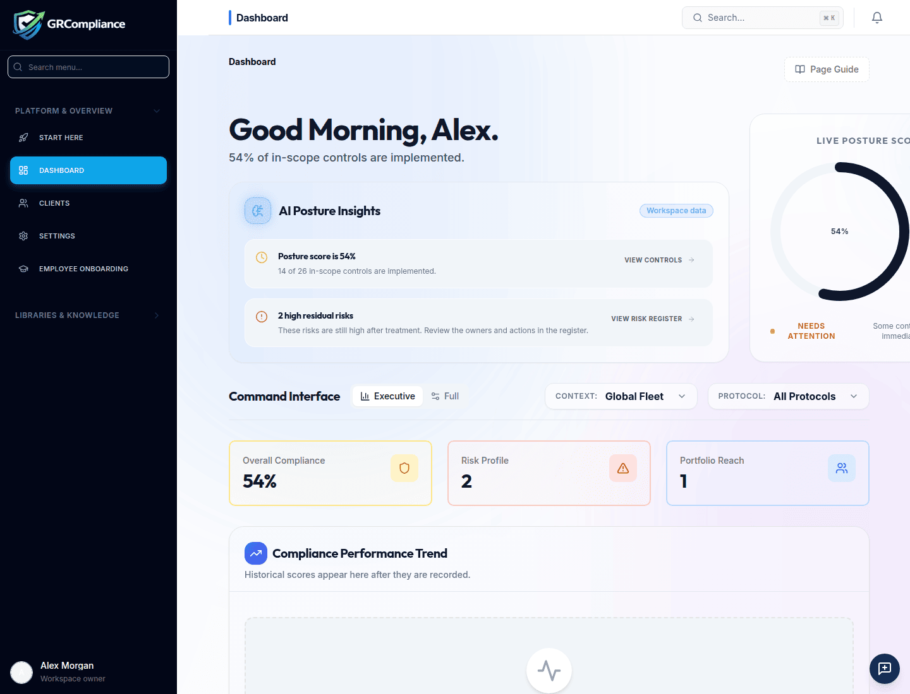
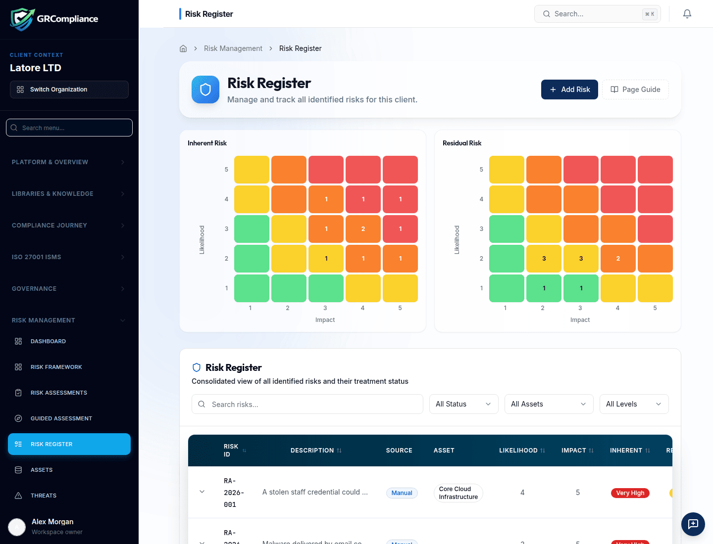
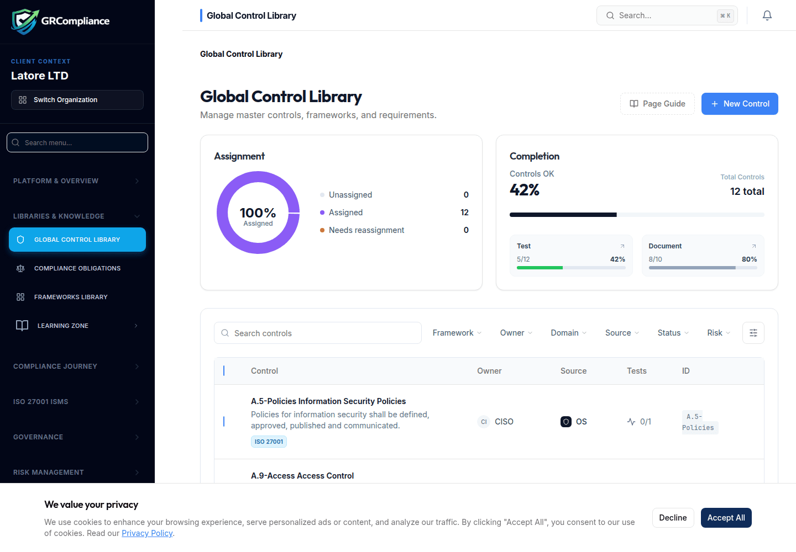
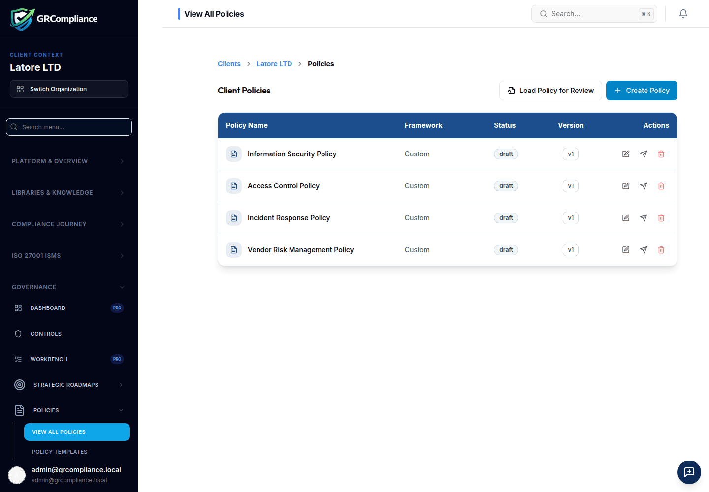
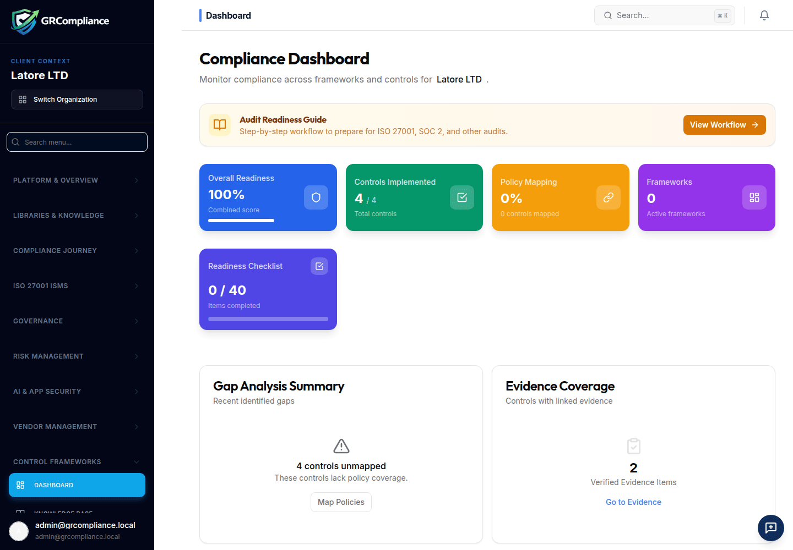
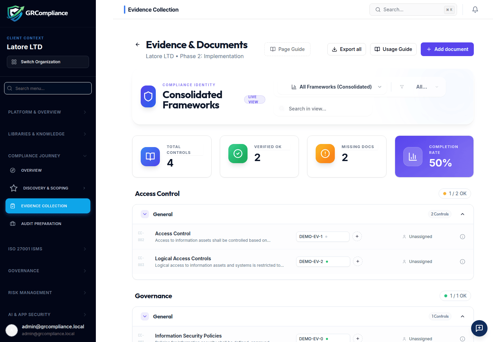

GRCompliance Core is self-hosted software for governance, risk, and compliance.
It keeps controls, policies, risks, evidence, and audits in one place so a team can see what is done and what is still open.
This repository is the open-source Core edition. Premium is the paid edition you run on your own host.

[](https://github.com/Sectutor/GRCompliance-Core/actions/workflows/ci.yml)
[](LICENSE)
[](https://github.com/Sectutor/GRCompliance-Core/pkgs/container/grcompliance-core)

The public site is [grcompliance.com](https://grcompliance.com).

## What you can do

Core includes a control library, a risk register, policies, evidence linked to controls, and an audit workspace. The frameworks page loads the catalogue below. Optional model calls stay in Core and run after an administrator stores a provider key in the app. The service supports OpenAI, Anthropic, and Google Gemini.

## Supported frameworks

The frameworks page loads **27** frameworks. The names below are the `name` fields of `export const frameworks` in [`packages/core/src/data/frameworks/index.ts`](packages/core/src/data/frameworks/index.ts), in that order.

1. ISO 27001:2022
2. ISO 22301:2019
3. HITRUST-Aligned (Representative)
4. SOC 2 Type II
5. NIST CSF 2.0
6. NIST SP 800-171 r2
7. PCI DSS v4.0.1
8. CIS Controls v8
9. CSA CCM v4
10. NIST SP 800-53 Rev 5
11. FedRAMP Moderate
12. Cyber Essentials / Plus
13. NIST AI RMF
14. OWASP AISVS (AI Security)
15. OWASP ASVS (App Security)
16. OWASP MASVS (Mobile Security)
17. OWASP SAMM (Maturity Model)
18. OWASP API Security Top 10
19. OWASP Web Top 10
20. OWASP Web Top 10 (2021)
21. Australian Essential Eight
22. CMMC 2.0
23. SOC 1 Type II
24. TISAX
25. NIST SP 800-161
26. Secure Controls Framework (SCF)
27. OWASP ML Security Top 10

The catalogue label for item 6 is `NIST SP 800-171 r2`. The bundled requirements in [`packages/core/src/data/frameworks/nist-800-171.ts`](packages/core/src/data/frameworks/nist-800-171.ts) are NIST SP 800-171 Revision 3.

SOC 1 Type II, TISAX, and Secure Controls Framework (SCF) are marked `bring-your-own` in the catalogue. Their publisher text is not in this repository. You upload a workbook. CSA CCM v4 is imported from a workbook as well. HITRUST-Aligned (Representative) and FedRAMP Moderate are representative lists in the catalogue. Control-text licences are recorded in [docs/framework-licensing.md](docs/framework-licensing.md).

The control import route also accepts FedRAMP Low, FedRAMP High, and OWASP SCVS ([`packages/core/src/server/routers/frameworks.ts`](packages/core/src/server/routers/frameworks.ts)). Those three are not entries in the catalogue above, so they are not part of the 27.

### Obligations the app loads

The obligations page loads a separate list of **15** entries from `export const regulations` in [`packages/core/src/data/regulations/index.ts`](packages/core/src/data/regulations/index.ts):

1. UK GDPR (United Kingdom General Data Protection Regulation)
2. VCDPA (Virginia Consumer Data Protection Act)
3. CPA (Colorado Privacy Act)
4. CTDPA (Connecticut Data Privacy Act)
5. UCPA (Utah Consumer Privacy Act)
6. HIPAA (Health Insurance Portability and Accountability Act)
7. COPPA (Children's Online Privacy Protection Act)
8. GLBA (Gramm-Leach-Bliley Act)
9. ISO/IEC 27701 (Privacy Information Management)
10. ISO/IEC 29100 (Privacy Framework Architecture)
11. PIPEDA (Personal Information Protection and Electronic Documents Act)
12. LGPD (Lei Geral de Proteção de Dados Pessoais)
13. APPI (Act on the Protection of Personal Information)
14. Australia Privacy Act 1988 & APPs
15. Architectural Privacy Standards (GPC & IAB TCF)

Source files for GDPR, the EU NIS2 Directive, EU DORA, CCPA / CPRA, and the EU AI Act exist under `packages/core/src/data/regulations/`. That index does not import them, so the obligations page does not show them. `cmmc.ts` in the same folder is also not imported there. CMMC 2.0 is framework 22 above.

## Editions

Core, in this repository, is the Community edition. It is licensed under AGPL-3.0-only. GRCompliance is the licensor.

Premium is the self-hosted paid edition. This repository does not list prices. Premium server APIs stay closed until the paid edition registers its entitlement when the server starts. These capabilities are the ones named in [`packages/core/src/lib/upgradeCopy.ts`](packages/core/src/lib/upgradeCopy.ts):

- MCP
- Automatic evidence collection, including API evidence ingest
- Integrations for GitHub, SIEM, SOAR, threat intel, and vulnerability scanners
- Prowler and Trivy scanner add-ons
- Multilingual support

The Community menu hides these entries. They are marked premium in [`packages/core/src/components/DashboardLayout.tsx`](packages/core/src/components/DashboardLayout.tsx). Setting `VITE_ENABLE_PREMIUM` to the exact value `true` can show them in the browser. That flag does not authorize the server.

- Workbench
- Adversary Intelligence
- Vulnerability Workbench
- AI Governance
- Threat Modeling
- CRM Dashboard
- Advisor Workbench

A Community instance can keep the seeded Latore LTD demo workspace and one other workspace. The server enforces that cap when you create or switch workspaces. A license string in the environment does not raise the cap. The workspace plan changes after a purchase is verified. **Settings → Updates** replaces the Core image only.

A commercial licence for terms other than AGPL-3.0-only is the template in [LICENSE-COMMERCIAL.md](LICENSE-COMMERCIAL.md). Write to sales@grcompliance.com or legal@grcompliance.com.

## Install

Commands below match `install.sh`, `install.ps1`, `docker-compose.yml`, `docker-compose.local-ports.yml`, `.env.example`, and [INSTALL.md](INSTALL.md).

### Prerequisites

For the container install:

- Docker, with the daemon running
- The Docker Compose plugin (`docker compose`)
- `curl`
- `openssl` on Linux and macOS (the shell installer uses it to generate secrets)
- `git` only when the published image cannot be pulled and the installer builds from a clone

On Windows, use Docker Desktop and PowerShell. `install.ps1` generates secrets with the Windows cryptography API. It exits before it writes secrets when it is not running on Windows.

For a Node checkout, [INSTALL.md](INSTALL.md) asks for Node.js 20 or newer, npm, PostgreSQL 15 or newer, and git. The container database image is `pgvector/pgvector:pg16`. The schema uses that image for embeddings. Redis in Compose is `redis:7-alpine` and starts with a password.

### Container install (Linux and macOS)

The installer creates `~/grcompliance` (or `GRC_HOME`), downloads the Compose files, writes `.env` with mode 600, and starts the stack.

```bash
curl -fsSL https://raw.githubusercontent.com/Sectutor/GRCompliance-Core/main/install.sh | bash
```

Publish Postgres and Redis on `127.0.0.1` only when a host client needs them. The default leaves both on the Compose network.

```bash
curl -fsSL https://raw.githubusercontent.com/Sectutor/GRCompliance-Core/main/install.sh | bash -s -- --bind-local
```

Choose another directory with `--dir` or `GRC_HOME`:

```bash
curl -fsSL https://raw.githubusercontent.com/Sectutor/GRCompliance-Core/main/install.sh | bash -s -- --dir /opt/grcompliance
```

The installer writes `APP_URL` into `.env`. The app uses that address for sign-in and for links. Set it to the address you will open in the browser before the first install. If `APP_URL` is unset, the installer reads `PUBLIC_URL`, then `http://localhost:` plus `APP_PORT`.

```bash
export APP_URL=https://grc.example.com
curl -fsSL https://raw.githubusercontent.com/Sectutor/GRCompliance-Core/main/install.sh | bash
```

`APP_URL` must be an absolute `http` or `https` URL for this instance. The installer refuses a host of `grcompliance.com` or a subdomain of it.

When `/health` returns HTTP 200, the installer prints that address. If `/health` is still failing after the retries, the installer exits non-zero and prints `docker compose logs` hints. `HEALTH_RETRIES` changes the attempt count (default 90, five seconds apart). These installer variables are read by `install.sh`. They are not all keys in `.env.example`: `PUBLIC_URL`, `HEALTH_RETRIES`, `GRC_HOME`, and `GRC_BIND_LOCAL`.

Running the installer again keeps the existing `.env`, database, and uploaded files.

### Container install (Windows)

```powershell
irm https://raw.githubusercontent.com/Sectutor/GRCompliance-Core/main/install.ps1 | iex
```

```powershell
$env:APP_URL = "https://grc.example.com"
irm https://raw.githubusercontent.com/Sectutor/GRCompliance-Core/main/install.ps1 | iex
```

### Manual Docker Compose install

Use this when you already have a clone and want to build the image yourself.

```bash
git clone https://github.com/Sectutor/GRCompliance-Core.git
cd GRCompliance-Core
cp .env.example .env
chmod 600 .env
mkdir -p updater-state
: > updater-state/release.env
chmod 600 updater-state/release.env
```

Replace every placeholder in `.env` with a secret you generate, and keep those secrets in `.env` only. `DATABASE_URL` must use the Compose service name `db` and `sslmode=disable` for the bundled Postgres, which is the shape in `.env.example`. Compose also reads `updater-state/release.env`. That file stays empty until an upgrade writes a pin. Create it before the first `docker compose up` when you did not use the installer.

```bash
docker compose up -d --build
```

The app container listens on port 3001. The host port is `APP_PORT` (Compose uses 3001 when that variable is unset). Postgres and Redis are not published. To bind them to `127.0.0.1` only:

```bash
docker compose -f docker-compose.yml -f docker-compose.local-ports.yml up -d --build
```

To change `APP_URL` after the first install, edit `.env` and start the stack again from that directory:

```bash
docker compose up -d
```

### Node checkout

[INSTALL.md](INSTALL.md) is the supported path for a Node checkout.

```bash
git clone https://github.com/Sectutor/GRCompliance-Core.git
cd GRCompliance-Core
npm install
cp .env.example .env
```

Set `DATABASE_URL` to your own PostgreSQL instance. Generate `JWT_SECRET` and `ENCRYPTION_KEY` yourself. Leave Supabase variables unset when `AUTH_MODE` is `local`. Set `VITE_SUPABASE_URL`, `VITE_SUPABASE_ANON_KEY`, and the server-only `SUPABASE_SERVICE_ROLE_KEY` only when you bring your own Supabase project.

```bash
npm run db:push
npm run server
npm run dev
```

Run the API and the web app in two terminals. The API listens on port 3001. The web app listens on port 5173.

## Environment variables

Names from [`.env.example`](.env.example). Values stay in your own `.env`. This file does not repeat them.

| Name | Purpose |
| --- | --- |
| `POSTGRES_USER` | Database role for the bundled Postgres. |
| `POSTGRES_PASSWORD` | Database password. |
| `POSTGRES_DB` | Database name. |
| `DATABASE_URL` | Connection string the app uses. For the bundled Postgres it must include `sslmode=disable` and the host `db`. |
| `DATABASE_SSL` | Set false for the bundled Postgres container. |
| `REDIS_PASSWORD` | Redis password. Redis refuses connections that omit it. |
| `JWT_SECRET` | Signs local session tokens. Generate it locally. |
| `ENCRYPTION_KEY` | Encrypts sensitive values at rest. Generate it locally. |
| `ADMIN_EMAIL` | Email of the first administrator. |
| `ADMIN_PASSWORD` | Password of the first administrator. Applied when that account is created. |
| `APP_URL` | Address this instance accepts for sign-in and uses in links. |
| `APP_PORT` | Host port mapped to the app container. |
| `PORT` | Port the server process binds. Compose sets this inside the app container. |
| `CORS_ORIGIN` | Browser origin allowed to call the API. |
| `GRC_VERSION` | Image tag used when `GRC_IMAGE` is unset. `latest`, or a release tag. |
| `GRC_IMAGE` | Optional pin written by the updater, image name, tag, and digest. |
| `GRC_UPDATER_VERSION` | Updater image tag. |
| `GRC_AIRGAP` | Set to `1` to disable the update button and refuse pulls. |
| `UPDATER_SECRET` | Shared by the app and the updater sidecar. The app container does not receive the Docker socket. |
| `AUTH_MODE` | `local` for the bundled login. `supabase` when you bring your own Supabase project. |
| `GRC_COOKIE_CONSENT` | Set to `1` to show an optional in-browser preference notice. The app does not load advertising or analytics scripts. |
| `POSTGRES_HOST_PORT` | Loopback port for Postgres when the local-ports overlay is used. |
| `REDIS_HOST_PORT` | Loopback port for Redis when the local-ports overlay is used. |
| `VITE_SUPABASE_URL` | Supabase project URL. Leave unset when `AUTH_MODE` is `local`. |
| `VITE_SUPABASE_ANON_KEY` | Supabase anon key. Leave unset when `AUTH_MODE` is `local`. |
| `SUPABASE_SERVICE_ROLE_KEY` | Supabase service role key. Server only. Leave unset when `AUTH_MODE` is `local`. |
| `RATE_LIMITING_ENABLED` | Turns request rate limiting on or off. |
| `RATE_LIMIT_MAX_REQUESTS` | Request cap for the rate-limit window. |
| `RATE_LIMIT_WINDOW_MS` | Rate-limit window length. |
| `VITE_ENABLE_PREMIUM` | Exact `true` may show premium menu entries in the browser. It does not authorize premium APIs. |
| `PREMIUM_PURCHASE_URL` | Optional purchase page. When unset, the app links to the public site. |
| `VITE_APP_MODE` | When the value is `demo`, the server refuses mutations other than sign-in and registration. |
| `OPENAI_API_KEY` | Named in the example file. The LLM service reads provider keys stored in the database, not this variable. |
| `SENDGRID_API_KEY` | Optional email provider key. The mailer reads this variable. |
| `STRIPE_SECRET_KEY` | Named in the example file for an optional Stripe integration. |
| `AWS_ACCESS_KEY_ID` | Named in the example file. Storage selects its S3 class when this and `S3_BUCKET_NAME` are both set. That class in `packages/core/src/lib/storage.ts` logs and returns a placeholder. `S3_BUCKET_NAME` is not in the example file. |
| `AWS_SECRET_ACCESS_KEY` | Named in the example file. Application code in this repository does not read it. |

## First login

Wait until `/health` returns HTTP 200, then open the address in `APP_URL`. The installer prints that address. That address renders the sign-in page. The same page is at `/login`. Protected pages redirect there when there is no session.

Sign in with `ADMIN_EMAIL` and `ADMIN_PASSWORD`. The installer prints the password once, while it writes `.env`, and does not print it again. The bootstrap creates the administrator with role `admin` and stores the password only when that account is first created. The same first start seeds a demo workspace named Latore LTD.

`AUTH_MODE=local` uses that local account. It does not call Supabase.

## Upgrade

An administrator opens **Settings → Updates**. When a newer Core release exists, the button says **Update available → Upgrade now**.

The app container does not receive the Docker socket. The updater sidecar does. It checks free disk, backs up Postgres and uploaded files, pulls `ghcr.io/sectutor/grcompliance-core` at a pinned tag and digest, recreates the app, and waits for `/health`. If the new app does not become healthy, it starts the previous image again and restores the database backup when the schema version changed. `GRC_AIRGAP=1` disables the button and the pull. The update stays on Core. Details are in [docs/updates.md](docs/updates.md).

The install directory does not contain `install.sh`. The manual fallback is:

```bash
curl -fsSL https://raw.githubusercontent.com/Sectutor/GRCompliance-Core/main/install.sh | bash -s -- --upgrade
```

Windows (PowerShell):

```powershell
iex "& { $(irm https://raw.githubusercontent.com/Sectutor/GRCompliance-Core/main/install.ps1) } -Upgrade"
```

`--upgrade` keeps the existing `.env`, pulls the Core image, and recreates the app container. If `UPDATER_SECRET` is missing, the installer appends one and leaves every other value unchanged. If the image is not published yet, it rebuilds from a git clone. The administrator password is not rotated.

To roll back by hand, set `GRC_IMAGE` in the install directory's `.env` to the previous image reference (`name:tag@sha256:…`), then run the same `--upgrade` command. Backups from a button upgrade are on the `grc_backups` volume.

## Backup

[`scripts/backup.sh`](scripts/backup.sh) and [`scripts/restore.sh`](scripts/restore.sh) back up the database and uploaded files and record SHA-256 checksums. Defaults match this Compose file: role `grc`, database `grcompliance`, uploads on the `grc_uploads` volume mounted at `/app/uploads`. The Compose project name is `grcompliance`. Local accounts live in the database, so the auth archive is skipped unless you set `AUTH_DIR`. The database password has no default in those scripts. See [Backup and restore](docs/BACKUP-RESTORE.md).

## Screenshots

Screenshots of a real install are welcome. Add a PNG under `docs/screenshots/`, link it in this section, and follow [CONTRIBUTING.md](CONTRIBUTING.md). Please use a capture from the running app.

These files are already in the repository:













<!-- TODO: screenshot of /login after a fresh install. Save it as docs/screenshots/sign-in.png -->
<!-- TODO: screenshot of the frameworks catalogue showing the shipped list. Save it as docs/screenshots/frameworks.png -->
<!-- TODO: screenshot of Settings → Updates. Save it as docs/screenshots/updates.png -->

## Contributing

See [CONTRIBUTING.md](CONTRIBUTING.md). Screenshots of the running app are welcome in the section above.

## Security

See [SECURITY.md](SECURITY.md). Report a vulnerability in private. Do not commit `.env` files, credentials, or customer evidence.

## License

GRCompliance is the licensor. The source in this repository is licensed under the GNU Affero General Public License version 3 only (AGPL-3.0-only). See [LICENSE](LICENSE) and [NOTICE.md](NOTICE.md).

If you modify GRCompliance and offer it as a network service, AGPL-3.0-only requires you to offer the corresponding source to users of that service.

Organizations that need terms other than AGPL-3.0-only can use the commercial template in [LICENSE-COMMERCIAL.md](LICENSE-COMMERCIAL.md). Write to sales@grcompliance.com or legal@grcompliance.com.

Source checkout: [https://github.com/Sectutor/GRCompliance-Core.git](https://github.com/Sectutor/GRCompliance-Core.git).
